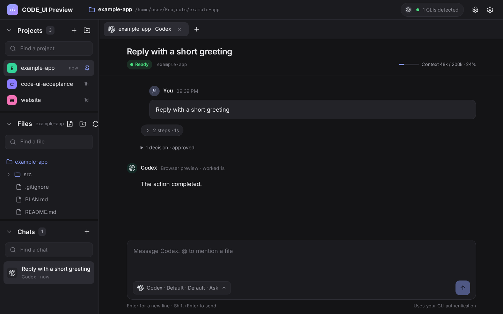
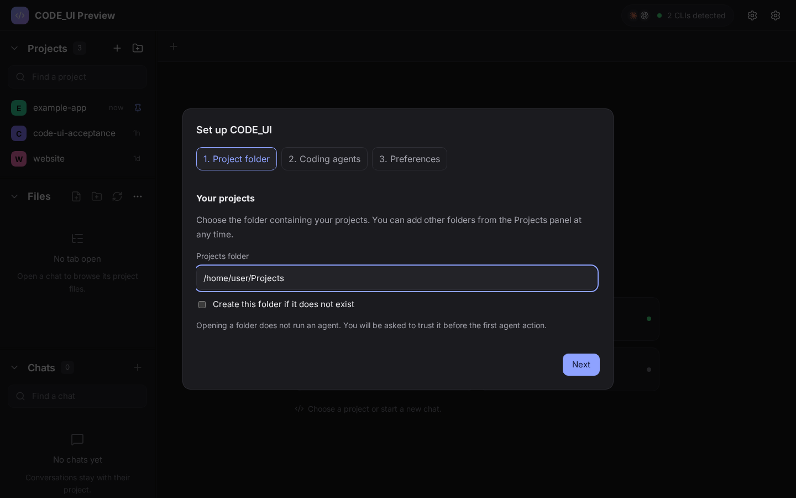

# CODE_UI

A Linux desktop workspace for coding agents. Keep project folders, conversations, files and context handoffs together while using the agent CLIs you already have.

**Status: early alpha, `0.1.0-alpha.1`.** Linux x86-64 is the initial target. Claude Code and Codex are the primary integrations; Antigravity and Muse are optional experimental integrations. CLI updates can change behavior. There is no guarantee that every CLI version or Linux distribution works.



*Browser preview with synthetic data. No private projects or conversations appear in these screenshots.*

## What it does

- Browse, pin and create projects in your chosen folder, or add folders elsewhere.
- Keep multiple chats open across projects and agents, with drafts and tabs restored on restart.
- Switch agents within a conversation, passing missed messages, the last reply, or a summary from the outgoing agent.
- Follow tool activity, answer questions and handle supported approval requests.
- Browse and edit project files, preview Markdown and images, and insert file references with `@` or drag and drop.
- Queue messages, stop a turn and retry interrupted work.
- Optionally discover conversations started in a CLI and continue their native sessions.

CODE_UI runs separately installed CLIs. Requests use those CLIs' authentication, provider connections and usage limits. You do not need every supported CLI installed. Detection checks the executable and its version; it does not establish that you are signed in.

## Install

Download the Linux x86-64 AppImage or Debian package from [Releases](https://github.com/broeh/code-ui/releases). Alpha candidates are marked as prereleases. During preparation, artifacts remain in a draft release until the release checks and final review are complete.

- **AppImage:** mark the downloaded file executable and run it. Your distribution may require FUSE support or AppImage extraction support.
- **Debian package:** install the downloaded `.deb` with your distribution's package installer so runtime dependencies are resolved.

The build baseline is Ubuntu 22.04 with WebKitGTK 4.1. Other distributions are best effort until explicitly tested. macOS, Windows and ARM packages are outside this alpha. Rust, Node.js and Python are only needed to build or develop the app, not to use a downloaded binary.

## First run

1. Choose the folder containing your projects. The suggestion is `~/Projects`; any suitable folder can be used or created.
2. Enable your CLIs. Automatic detection uses your login-shell environment. Choose an executable path when needed, then use **Check again**.
3. Choose a default agent and permission, optional CLI history discovery and desktop notifications.
4. Open or create a project and send a message. Trust the folder when prompted before the CLI starts project-specific behavior.

New installs default to **Ask**. **Full access** explicitly enables unrestricted execution where supported by the CLI. Agent permission modes differ; see [agent support](docs/agents.md). Approving a Claude plan starts work with approvals rather than silently granting full access.

Finish setup without a CLI if you want to browse first. Install and authenticate through the provider's official CLI, then revisit **Settings**. CODE_UI has no separate login service.



## Agent support

| Agent | Status | Integration | Main caveat |
| --- | --- | --- | --- |
| Claude Code | Primary | Streaming CLI input/output | Model aliases and task-tool support depend on CLI version |
| Codex | Primary | App Server | Plan permission mode and MCP elicitation are not supported by this app |
| Antigravity | Experimental | Streaming CLI input/output | Approval requests cannot be answered through the current print protocol; Plan may proceed to implementation |
| Muse | Experimental | Muse Session Protocol | No Plan permission mode; protocol compatibility is version-sensitive |

Installation references: [Claude Code](https://code.claude.com/docs/en/overview), [Codex](https://developers.openai.com/codex/cli/), [Antigravity](https://antigravity.google/docs/getting-started?tab=cli), [Muse SDK and CLI requirements](https://github.com/meta-models/muse-code-sdk).

## Settings and local data

Projects, enabled agents, executable overrides and history discovery can be changed in **Settings**. CLI changes apply to future processes; an already running session continues with its current process. Existing explicit chat permissions are preserved. Legacy installations retain their configured project path and execution preferences.

On Linux, stable settings normally live in `~/.config/code-ui/settings.json`; conversations and logs normally live under `~/.local/share/code-ui/`. XDG configuration/data locations are respected. Preview builds automatically use separate `code-ui-preview` directories and a separate application identifier.

Conversations, tool output and drafts are stored locally in plain text with owner-only access to app data. Answers to questions marked secret are redacted from retained interaction records. A secret-input prompt stops further protocol and stderr retention for that process. Provider output and the CLIs' own histories may contain sensitive information. Review any diagnostic material before sharing it. See [security and privacy](SECURITY.md).

Back up settings and the SQLite database before replacing a stable version. Older binaries may need the matching database backup after a schema change. Preview builds allow testing without replacing the stable installation or migrating its database.

## Current limitations

- Dark theme and Linux desktop support only.
- Chat search matches titles, not full conversation contents.
- File drops insert paths; they are not image or document uploads.
- Imported terminal history copies available conversation text. Later terminal changes do not automatically synchronize into the app.
- Permission, effort, question and history features differ between providers.
- Context display reports available token information, not a billing or rate-limit dashboard.
- No Git changes view, integrated terminal emulator, cloud synchronization or automatic updater.

See the [roadmap](docs/roadmap.md) and [troubleshooting guide](docs/setup.md).

## Development

The pinned toolchain is Node.js 26.7.0, npm 11.19.0 and Rust 1.99.0. Linux native builds also need [Tauri's system prerequisites](https://v2.tauri.app/start/prerequisites/). Release notice generation uses Python 3.10 or later.

```bash
npm ci
npm test
npm run build
npm run check:rust
```

`npm run dev` opens a browser preview with mock data. It cannot run real agents or access native project files. For an isolated desktop development build:

```bash
npm run preview:desktop
```

`tools/install.sh --fast` builds and installs `~/.local/bin/code-ui-preview`, leaving the stable binary in place. The compiled preview identifier selects separate app data even when it is launched without environment variables.

Browser workflow checks use synthetic data:

```bash
npx playwright install chromium
npm run test:ui
```

See [CONTRIBUTING.md](CONTRIBUTING.md) for native testing, protocol fixtures and packaging, and [architecture](docs/architecture.md) for the code layout.

## License

CODE_UI's original source is [MIT licensed](LICENSE). Dependencies, fonts and provider icons retain their own licenses. See [third-party notices](THIRD_PARTY_NOTICES.md). Provider CLIs are not bundled. CODE_UI is an independent project; provider names identify integrations and do not imply endorsement.
